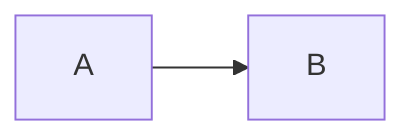

# md-server

A self-hosted markdown rendering server using Caddy and Pandoc. Drop markdown files in a directory and browse them as styled HTML with file browsing, table of contents, callouts, code copy buttons, and print-friendly output.

## Quick Start

```bash
git clone <this-repo> md-server
cd md-server
mkdir -p docs   # put your .md files here
docker compose up -d
```

Browse to **http://localhost:8095**

## Serving a Different Directory

By default, files are served from `./docs/`. To serve markdown from elsewhere, create a `.env` file:

```
DOCS_DIR=/path/to/your/markdown
```

Or inline:

```bash
DOCS_DIR=~/notes docker compose up -d
```

## Features

### Rendering Modes

Append suffixes to any `.md` URL to change the output:

| Suffix | Effect |
|--------|--------|
| *(none)* | Compact layout (default), continuous flow |
| `.full` | Roomier layout, larger fonts |
| `.break` | Page break before each H2 (for printing) |
| `.toc` | Adds a table of contents |
| `.meta` | Includes the tags/related strip and backlinks when printing |
| `.compact` | Accepted for old links (same as default) |

Suffixes combine: `doc.md.toc.break` gives you a TOC with page breaks.

You don't need to remember them: every page has a bar at the top (screen only, never printed) with the layout choices, a Contents checkbox, a "Print tags & links" checkbox, **Print / PDF**, and **Open in Obsidian**. Hover over any of them for a short explanation. The Obsidian button appears when `OBSIDIAN_VAULT` is set to the vault's name in `.env`.

Above the controls, breadcrumbs show the note's folder path (Home › folder › note); each folder opens its file listing. **Recent** opens `/_recent`, the notes changed today, in the last 7 days or in the last 30 days, newest first and grouped by day.

All modes follow your OS/browser dark-mode preference on screen; printed output always stays light.

### Callouts

GitHub-style alert syntax is supported:

```markdown
> [!NOTE]
> This renders as a styled callout box.
```

Supported types: the 5 GitHub alerts (`NOTE`, `TIP`, `IMPORTANT`, `WARNING`, `CAUTION`) plus Obsidian's extended set (`info`, `todo`, `abstract`, `quote`, `success`, `example`, `question`, `failure`, `danger`, `bug`, and their aliases).

### Mermaid Diagrams

Fenced code blocks with the `mermaid` language are rendered as diagrams client-side (mermaid.js is bundled into the sidecar image — no CDN needed at view time):

````markdown

````

### Wiki Links

Obsidian-style `[[wiki links]]` are resolved against the served directory. Supports `[[file]]`, `[[file|display text]]`, and `[[file#heading]]`. Embeds (`![[image.png|300]]`, video, audio, PDF) are supported too. Links inside code are left alone.

### Tags and Related Notes

Frontmatter `tags:` and `related:` show as a strip under the title: tags as chips, related entries as links (`[[wiki links]]` resolve like any other). The strip is on screen only; to print it, tick "Print tags & links" or add `.meta` to the URL.

Each note also lists its backlinks at the bottom ("Linked from"), newest first: every note whose `[[wiki link]]`, embed, frontmatter link or relative `.md` link resolves to it. Links inside code are ignored. They follow the same print toggle.

Inline `#tags` in the body get the same chip style, following Obsidian's rules (`#123` and `foo#bar` aren't tags; tags in link text and code are left alone).

```yaml
tags:
  - ukg/rollout
related:
  - "[[UKG Rollout Questions]]"
```

### Highlights

Obsidian `==highlighted text==` renders as a highlight (light, dark and print). A leading colored circle picks the color and is hidden, as in Obsidian's reading view: `==🔴text==`, plus 🟠 🟡 🟢 🔵 🟣.

### Other

- File browser for navigating directories; a directory containing `index.md` or `README.md` renders it instead of the raw listing
- Automatic dark mode (`prefers-color-scheme`)
- Copy button on code blocks
- DRAFT watermark when frontmatter contains `status: DRAFT`
- Footer with source filename and timestamps
- Syntax highlighting via Pandoc (kate theme)

## Architecture

Two containers:

- **caddy** — serves the file browser and proxies `.md` requests to the sidecar
- **pandoc-sidecar** — a Python HTTP server that reads the markdown file, resolves wiki links, and runs Pandoc to produce styled HTML

## Changing the Port

Edit the port mapping in `docker-compose.yml`:

```yaml
ports:
  - "8095:80"  # change 8095 to whatever you want
```

## Security

This server has no authentication and serves over plain HTTP — intended for local or trusted-network use.

Notes may contain raw HTML, as in Obsidian, so anyone who can write to the served folder can put script on its pages. Hidden files and folders (`.obsidian`, `.git`, `.env`) are never served or listed, and a symlink is served only when it points to a visible file inside the served folder.

Since it already uses Caddy, you can add security directly in the Caddyfile:

- **Basic auth:** add a `basicauth` block ([Caddy docs](https://caddyserver.com/docs/caddyfile/directives/basicauth))
- **HTTPS:** replace `:80` with your domain and remove `auto_https off` — Caddy handles certificates automatically
- Or put it behind [Tailscale](https://tailscale.com/), [Cloudflare Tunnel](https://developers.cloudflare.com/cloudflare-one/connections/connect-networks/), etc.

## License

[Unlicense](LICENSE) — public domain. Do whatever you want with it.
